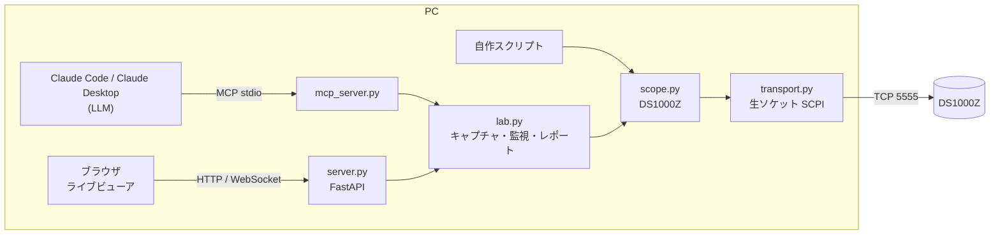

# rigol-ds1000z

RIGOL DS1000Z シリーズ（DS1054Z / DS1074Z / DS1104Z など）を LAN から高速に制御・計測するための Python ライブラリです。REST/WebSocket API と、LLM から操作するための MCP サーバーも含みます。

- VISA や公式 SDK は使いません。TCP 5555 番ポートに生の SCPI を送ります。
- 実機（DS1104Z、FW 00.04.04.SP3、USB-LAN 100Mbps 直結）で計測した癖を設計に反映しています。

- **サンプル**: [プローブ補正の評価レポート](https://necobit.github.io/RIGOL-1054Z-HACK/samples/probe-evaluation/)（GitHub Pages、[トップ](https://necobit.github.io/RIGOL-1054Z-HACK/)）

## 構成



## 事前調査のまとめ

- **公式SDK**
  - RIGOL が公開しているのは IVI ドライバ、Ultra Sigma、VISA ベースの MATLAB / C# サンプルです。
  - 公式の Python SDK はありません。
  - LAN 制御は、生ソケット（port 5555）に SCPI を送るだけで動きます。VISA は不要です。
- **プロトコル**
  - 生 TCP 5555 と VXI-11（portmapper 111）の両方に対応しています。
  - VXI-11 経由の読み出しは遅いと報告されています（python-vxi11 で 24M 点に 21 分以上）。このため生ソケットを採用しました。
- **既存ライブラリ**
  - pklaus/ds1054z（VXI-11）、Rigol1000z（PyVISA）、sigrok があります。
- **既知のバグ**
  - FW 00.04.04.SP3 では、範囲外の `:WAV:STAR` を送ると SCPI がハングし、復旧には電源の入れ直しが必要になります（EEVblog での報告）。
  - このライブラリは範囲チェックをしたうえで、STAR ≤ STOP を常に保つ順序で設定を送ります。

参考資料:
- DS1000Z Programming Guide
- [sigrok wiki](https://sigrok.org/wiki/Rigol_DS1054Z)
- [EEVblog の速度比較スレッド](https://eevblog.com/forum/testgear/download-speed-from-rigol-ds1054z-or-similar-oscilloscope-to-a-pc)

## 実機で確認した挙動と、それに合わせた設計

| 観測した挙動 | 対策 |
|---|---|
| 照会コマンド（クエリ）の往復は 1〜3 ms | — |
| **設定コマンドは 1 個あたり約 50 ms 本体が占有される**（まとめて送っても短くならない） | `:WAV:SOUR/MODE/FORM/STAR/STOP` の状態をキャッシュし、変化がなければ送らない |
| `;` で連結したクエリ（改行区切りで続けて送った場合も）は 1 行の `a;b;c` で返る | 状態取得やプリアンブル＋データ取得を 1 往復にまとめる（`:WAV:SOUR?;:WAV:PRE?;:WAV:DATA?`） |
| `measure error!` の応答だけ**末尾に改行がもう1つ付く**ため、以降の応答がずれる | 受信側で吸収して再結合する |
| 測定項目は、直近 5 組（項目×ch）までならキャッシュされ 1〜3 ms。6 組目以降は毎回約 410 ms | ホスト側で解析する方法（`Waveform.analyze()`）を用意 |
| 本体の画面バッファの更新は 11〜19 回/s 程度（24M 深度で約 11 回/s、AUTO で約 19 回/s） | `stream(only_new=True)` で重複フレームを捨てる |
| `:RUN` の直後約 100 ms は、画面データが 0 点で返る | 空データなら再取得する |
| `:RUN` の直後しばらくは、`:TRIG:STAT?` が `STOP` のまま返る | `run()` は状態が切り替わるまで待つ |
| RUN 直後に STOP すると、RAW メモリに完全な取り込みが残らない | 期待した点数になるまで取り込みをやり直す |
| RAW の 1 回の読み出しは **最大 1,000,000 点**。それを超えると空ブロックが返る（ガイドの記載は 250k） | 1M 点単位で分割して読む |
| `:WAV:SOUR` は全接続で共有される状態（同時接続そのものは可能） | 応答に含まれるソースを毎回確認し、他のクライアントに変更されていたら取り直す |

## 実測パフォーマンス

条件: DS1104Z、USB 10/100 LAN 直結、プローブ補正信号 1 kHz、1 ms/div。

| 操作 | 実測 |
|---|---|
| `read_waveform(1)`（1200 点） | **3.2 ms（約 300 回/s）** |
| `stream([1])` の新しいフレーム | 約 12 回/s（本体の画面更新が上限） |
| `stream([1,2])` | 各 ch 19.5 回/s |
| `stream([1,2,3,4])` | 各 ch 5 回/s（ch 切り替えのコスト） |
| `read_waveforms([1,2,3,4], snapshot=True)`（時刻を揃えた4ch） | 約 280 ms |
| `measure()`（キャッシュ内の 3 項目） | 2.6 ms |
| `status()`（全設定） | 12〜14 ms |
| `read_raw(1)`（24M 点、全メモリ） | **16.6 s（1.45 M点/s）** |
| スクリーンショット PNG | 約 0.6 s |

**速く取るためのコツ**
- 1ch だけを取る場合が最速です。
- 本体の画面更新を速くしたいときは、`set_acquire(memory_depth="AUTO")` にします。
- 多 ch の値が欲しいだけなら、`measure_many([("VPP",1),("VPP",2),...])` を使います。5 組以内なら 1 往復で、ch 切り替えのコストもかかりません。

## セットアップ

```sh
uv venv --python 3.12 .venv
uv pip install --python .venv/bin/python -e ".[all]"     # numpy + FastAPI + MCP + matplotlib
```

オシロの IP は自動で検出します。VXI-11 のブロードキャストと、ARP テーブルにある RIGOL の OUI `00:19:AF` から探します。

- 今回の機体は DHCP のない USB-LAN 直結なので、リンクローカルアドレス `169.254.51.130` になっていました。
- IP を固定したい場合は、本体の Utility → IO → LAN で設定するか、環境変数 `RIGOL_HOST` を指定してください。

```sh
.venv/bin/rigol-ds discover
.venv/bin/rigol-ds bench              # この環境での速度を計測
.venv/bin/rigol-ds info               # 全設定を JSON で出力
.venv/bin/rigol-ds capture --plot     # 表示中の ch を CSV と PNG に保存
.venv/bin/rigol-ds capture --raw --points 1000000
.venv/bin/rigol-ds screenshot -o screen.png
```

## Python から使う

```python
from rigol_ds1000z import DS1000Z

with DS1000Z("169.254.51.130") as s:
    print(s.status())
    s.set_channel(1, scale=1.0, coupling="DC", probe=10)
    s.set_timebase(scale=500e-6)
    s.set_trigger(source=1, level=1.5, slope="POS", sweep="AUTO")

    wf = s.read_waveform(1)              # 1200 点、約 3 ms
    print(wf.volts, wf.times, wf.analyze())   # Vpp / Vrms / 周波数 / デューティ…

    for wf in s.stream([1], only_new=True):   # 新しいフレームだけを取り出す
        ...

    snap = s.read_waveforms([1, 2], snapshot=True)  # 時刻を揃えた複数 ch
    raw = s.read_raw(1)                  # メモリ全体（自動で STOP し、終了後 RUN に戻す）
    print(s.measure("VPP,FREQ,VRMS", 1))  # 本体側の測定
```

## REST / WebSocket API

```sh
.venv/bin/rigol-ds serve --port 8000          # http://127.0.0.1:8000/  ライブビューア
                                              # http://127.0.0.1:8000/docs  OpenAPI
```

| メソッド | パス | 内容 |
|---|---|---|
| GET | `/api/info`, `/api/status`, `/api/errors` | 識別情報 / 全設定 / エラーキュー |
| POST | `/api/control/{run,stop,single,force,autoscale,clear}` | 動作の制御 |
| PATCH | `/api/channels/{ch}`, `/api/timebase`, `/api/trigger`, `/api/acquire` | 設定の変更（送った項目だけを反映） |
| GET | `/api/waveform/{ch}?format=json\|csv\|bin` | 画面波形 |
| GET | `/api/waveforms?channels=1,2&snapshot=true` | 複数 ch |
| GET | `/api/raw/{ch}?start=&stop=&format=bin\|npy\|csv` | メモリ全体 |
| GET | `/api/analyze`, `/api/measure?items=VPP,FREQ&ch=1` | ホスト側解析 / 本体側測定 |
| GET | `/api/screenshot?format=PNG` | 画面キャプチャ |
| POST | `/api/scpi` `{"command": "..."}` | 任意の SCPI |
| WS | `/ws/stream?channels=1,2&format=bin\|json` | 新しいフレームを push |

**WebSocket のバイナリ形式**
- フレームは `[uint32 LE ヘッダ長][JSON ヘッダ][uint8 サンプル]` の順に並びます。
- 換算式は `volts = (sample - yoffset) * yinc`、`t = x0 + i*dx` です。
- ストリーミングは1つのスレッドが担当し、全クライアントに配信します。ビューアを何枚開いても、オシロへの負荷は増えません。

## LLM から使う（MCP）

このリポジトリでは `.mcp.json` に `rigol-scope` サーバーを登録済みです。`.venv` を作成したうえで Claude Code をこのディレクトリで起動すると、そのまま使えます。他のクライアントでは `rigol-ds mcp`（stdio）を登録してください。

Claude Desktop の設定例:

```json
{ "mcpServers": { "rigol-scope": {
    "command": "/path/to/RIGOL-1054Z-HACK/.venv/bin/rigol-ds", "args": ["mcp"] } } }
```

依頼の例:

- 「CH1 を自動調整して、周波数とデューティ比を測って」
- 「CH1 と CH2 を 30 秒監視して、Vpp の変動をレポートにまとめて」
- 「トリガを CH2 の立ち下がり 1.2V にしてシングルで取って、波形を見せて」

**主なツール**

| 分類 | ツール |
|---|---|
| 状態・制御 | `scope_status`、`scope_control`（run/stop/single/force_trigger/autoscale/clear） |
| 設定 | `set_channel`、`set_timebase`、`set_trigger`、`set_acquisition` |
| 取得 | `capture`（スナップショットとホスト側解析、プロット画像付き）、`monitor`（指定秒数の連続解析と統計） |
| 測定・保存 | `measure`、`screenshot`、`plot_capture`、`export_capture`、`export_monitor` |
| レポート | `report_create` → `report_add_text`、`report_add_capture`、`report_add_monitor`、`report_add_screenshot`、`report_add_table` → `report_finish` |
| その他 | `scpi`（任意の SCPI を送るための逃げ道） |

レポートは `rigol_data/reports/<日時>_<タイトル>/` に出力されます。画像を埋め込んだ自己完結の `report.html` と、`report.md` + PNG です。ツールの説明には上の実測タイミングを書いてあり、LLM が速い手段を自分で選べるようにしています。

## Mac 全体で使えるようにする（どのディレクトリの Claude からでも）

```sh
# 1. CLI と MCP サーバーを ~/.local/bin に入れる（editable なので、このリポジトリの変更が即反映される）
uv tool install --python 3.12 --editable "/path/to/RIGOL-1054Z-HACK[all]"

# 2. Claude Code に、ユーザー全体のスコープで登録する
claude mcp add --scope user rigol-scope \
  -e RIGOL_HOST=<オシロの IP> -e RIGOL_DATA_DIR="$HOME/Documents/rigol_data" \
  -- "$HOME/.local/bin/rigol-ds" mcp
```

- **Claude Desktop**: `~/Library/Application Support/Claude/claude_desktop_config.json` の `mcpServers` に、同じ command / args / env を追加して、アプリを再起動します。
- **スキル（任意）**: `~/.claude/skills/rigol-scope/SKILL.md` に接続情報・API 早見表・注意点を書いておきます。そうすると、Claude Code が独自の解析スクリプトを書くときにも、このライブラリを正しく使えます。スクリプトは `~/.local/share/uv/tools/rigol-ds1000z/bin/python` で実行します。
- **IP がずれた場合**: `RIGOL_HOST` のアドレスが応答しないと、自動検出に切り替わります。

## サンプル: プローブ補正の評価

`examples/probe_evaluation/` に、多スケール計測とプローブ補正評価を再現するスクリプトがあります。CH1 にテスト信号（プローブ補正端子など）を入れて実行してください。

```sh
.venv/bin/python examples/probe_evaluation/acquire.py --host 169.254.51.130   # 取得（約 1 分。終了後に設定を元に戻す）
.venv/bin/python examples/probe_evaluation/make_report.py                     # 解析してレポートを生成
```

生成例は [GitHub Pages](https://necobit.github.io/RIGOL-1054Z-HACK/samples/probe-evaluation/) で見られます（ソースは `docs/`）。

## テスト

```sh
.venv/bin/python -m pytest -q
```

実機の癖を再現するフェイクのオシロ（`tests/fake_scope.py`）を相手に動きます。オシロを接続しなくても実行できます。

## 注意

- 画面データは 8bit です（縦 8 div を約 200 段階で表現）。振幅を精密に測るときは、信号が画面いっぱいになるように V/div を調整してください。
- 走行中に複数 ch を順番に読むと、ch ごとに別の取り込みのデータになります。時刻を揃えたい場合は `snapshot=True` を使ってください（一瞬 STOP します）。
- RAW 読み出しの間はオシロが停止します。
