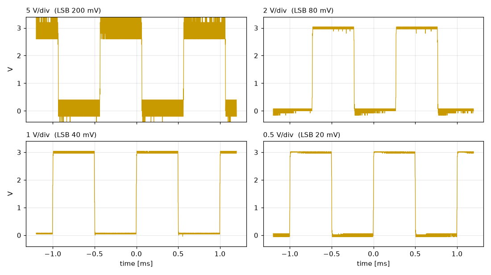
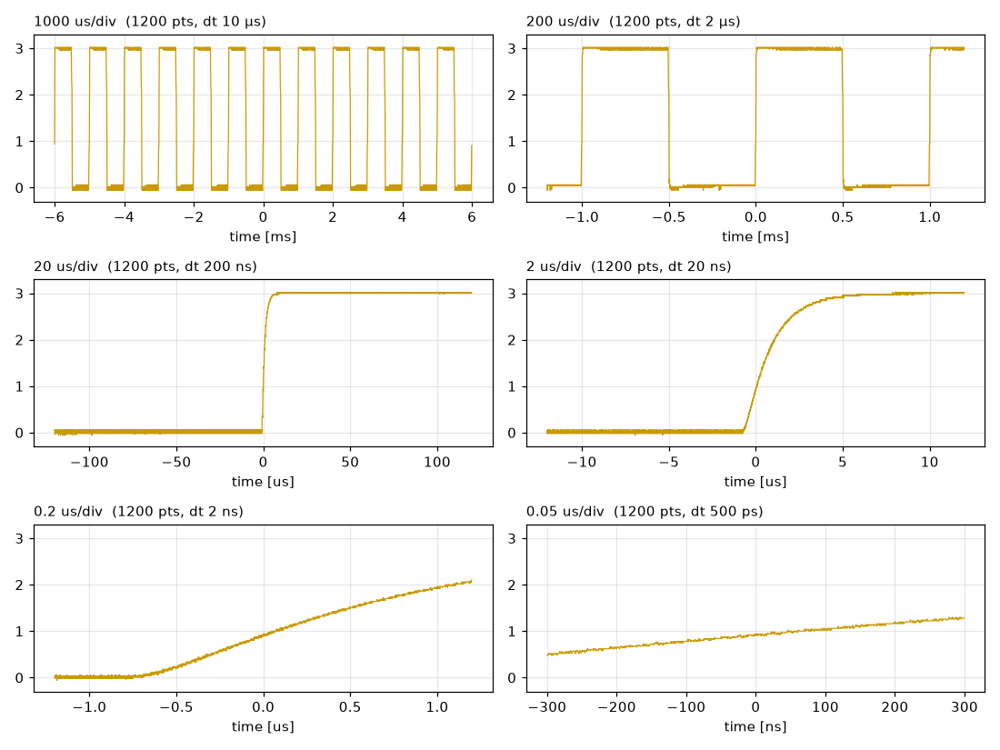
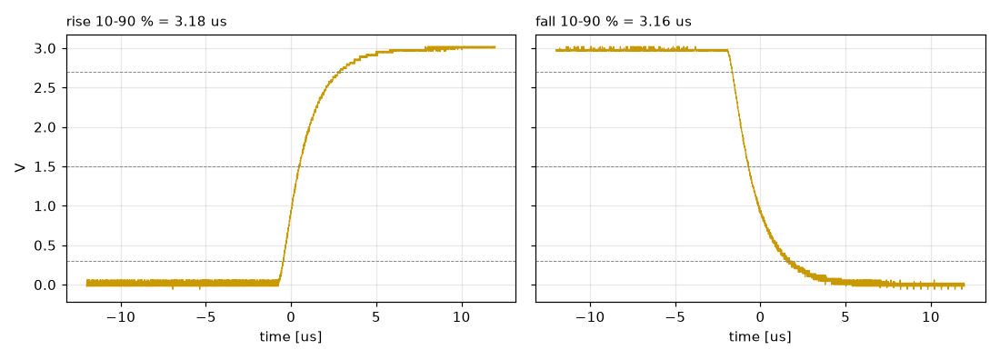
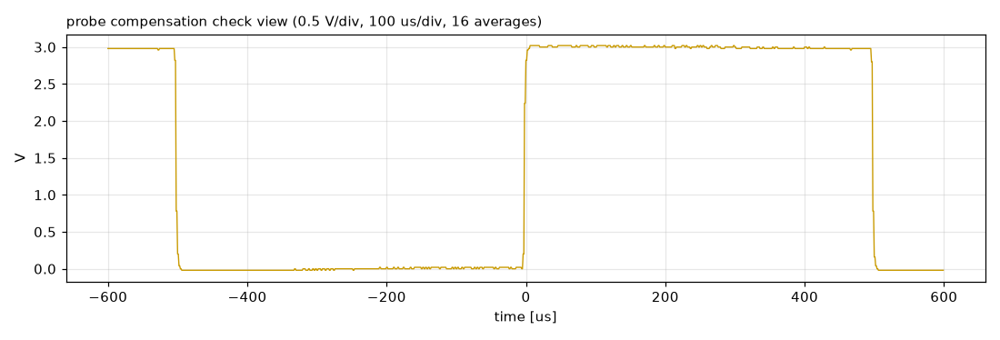
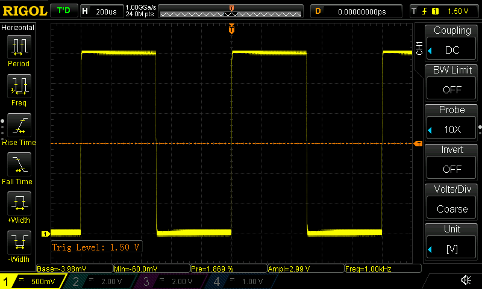

# CH1 テスト信号の多スケール計測とプローブ補正評価

_2026-10-18 12:36_

## 結論
- 信号は **1000 Hz・振幅 約 3.00 V（0.00 → 3.00 V）・デューティ 50.0 %** の方形波です。
- 立ち上がりは **3.18 µs**、立ち下がりは **3.16 µs**（10–90 %）です。RC 的になだらかな形で、リンギングはありません。
- **プローブ補正は良好**です。平坦部の傾きは上側 **+0.48 %**、下側 **+0.41 %** で、どちらも振幅比 ±1 % 以内に収まっています。
- 上側はエッジ直後がわずかに高く、下側はわずかに低く、どちらも時間とともに戻ります。これは**ごく軽い過補償寄り**の形です。完全にフラットを狙う場合だけ、トリマを角の出っ張りが減る方向へごくわずかに回してください。
- オシロの自動測定のうち立ち上がり時間は、**エッジ全体が画面に入る時間軸（2 µs/div 前後）のときだけ有効**です。200 ns/div 以下では誤った値が出ていました。

## 測定条件
- 機器: RIGOL TECHNOLOGIES DS1104Z（FW 00.04.04.SP3）、LAN（生 SCPI ソケット）で制御しました。
- CH1: プローブ 10×、DC 結合、帯域制限 OFF。
- トリガ: CH1 エッジ、1.5 V（平坦部を拡大したときは各平坦部の近くに設定）。
- 取り込み: 画面データ 1200 点/回。プローブ補正の評価のみ 16 回平均です。
- 取得日時: 2026-10-18 12:19。測定後、本体の設定は測定前の状態に戻しました。

## 1. 垂直スケールによる見え方の違い（200 µs/div）

*同じ信号を 4 通りの V/div で取得したもの。V/div が大きいほど量子化の段が粗くなります。*

| V/div | 1 LSB | Vtop | Vbase | Vamp | Vamp 誤差* | Vpp（ホスト） | 周波数 | デューティ |
|---|---|---|---|---|---|---|---|---|
| 5 V/div | 200 mV | 2.92 V | 85.6 mV | 2.874 V | -4.2 % | 3.8 V | 1000 Hz | 50.0 % |
| 2 V/div | 80 mV | 3 V | 14.63 mV | 2.985 V | -0.5 % | 3.2 V | 1000 Hz | 50.0 % |
| 1 V/div | 40 mV | 3 V | 26.34 mV | 2.974 V | -0.9 % | 3.08 V | 1000 Hz | 50.0 % |
| 0.5 V/div | 20 mV | 2.995 V | 0 V | 2.99 V | -0.3 % | 3.08 V | 1000 Hz | 50.0 % |

*Vtop〜デューティはオシロの自動測定、Vpp はホスト側の計算。*16 回平均の振幅 3.00 V を基準にした差*

- **5 V/div** では 1 LSB が 200 mV と粗く、振幅が約 4 % 小さく出ています。ホスト側の Vpp もノイズと量子化の影響で大きく膨らみました。
- **2 V/div 以下**では、振幅の誤差が ±1 % 以内に収まります。信号が縦 6 div を占める 0.5 V/div で、最も平均値に近い値になりました。
- 周波数とデューティは、どのスケールでも変わりません。ホスト側の周波数推定は、2.4 周期分の画面データだけを使うため ±0.2 % ほどばらつきます。正確な値が必要な場合は、オシロの周波数測定を使ってください。
- **精度よく振幅を測るには、信号が画面の縦 6〜8 div を占める V/div にする**のが基本です。

## 2. 時間軸スケールと立ち上がりエッジ（0.5 V/div）

*立ち上がりエッジ（画面中央 = トリガ点）を 1 ms/div から 50 ns/div まで拡大したもの*

| エッジ | 時間軸 | 画面幅 | サンプルレート | 立上/立下時間（自動測定） | 判定 | Overshoot | Preshoot |
|---|---|---|---|---|---|---|---|
| rise | 1 ms/div | 12 ms | 500 MSa/s | — | — | 0.84 % | 1.81 % |
| rise | 200 µs/div | 2.4 ms | 1 GSa/s | — | — | 0.88 % | 3.10 % |
| rise | 20 µs/div | 240 µs | 1 GSa/s | — | — | 0.40 % | 2.61 % |
| rise | 2 µs/div | 24 µs | 1 GSa/s | 3.22 µs | 有効 | 0.85 % | 2.68 % |
| rise | 200 ns/div | 2.4 µs | 1 GSa/s | 1.41 µs | 無効（エッジが画面外にはみ出す） | — | 2.57 % |
| rise | 50 ns/div | 600 ns | 1 GSa/s | 291.5 ns | 無効（エッジが画面外にはみ出す） | 29.92 % | 34.54 % |
| fall | 2 µs/div | 24 µs | 1 GSa/s | 3.3 µs | 有効 | 1.63 % | 2.33 % |
| fall | 200 ns/div | 2.4 µs | 1 GSa/s | 1.76 µs | 無効（エッジが画面外にはみ出す） | — | 2.18 % |
| fall | 50 ns/div | 600 ns | 1 GSa/s | 242.5 ns | 無効（エッジが画面外にはみ出す） | 30.93 % | 38.77 % |

*オシロの自動測定（RTIM / FTIM / OVER / PRES）*

- 1 ms/div・200 µs/div では、エッジが数点しかなく立ち上がり時間は測れません（自動測定の結果も無効値）。
- **2 µs/div** でエッジ全体が画面に入り、自動測定とホスト側の計算（下記）が一致しました。
- 200 ns/div・50 ns/div ではエッジの途中しか画面に入りません。自動測定は**もっともらしいが誤った値**を返し、Overshoot も 30 % のような無意味な値になります。自動測定は、測りたい現象全体が画面に入っていることを確認してから使ってください。
- 平均化していない取り込みでは、Overshoot / Preshoot が 1〜3 % と大きめに出ています。0.5 V/div での 1 LSB（20 mV）は振幅の約 0.7 % にあたり、1 回分のノイズのピークを拾っているためです。16 回平均すると 1 % 未満に下がります（次節）。小さな行き過ぎを評価するときは、平均化と垂直方向の拡大を組み合わせてください。

*2 µs/div での立ち上がりと立ち下がり（破線は 10 / 50 / 90 % のレベル）*

- ホスト側の計算では、10–90 % の立ち上がりが 3.18 µs、立ち下がりが 3.16 µs でした（サンプル間隔 20 ns）。上下でほぼ対称です。
- エッジの形は 1 次の RC 応答（時定数 τ ≈ 1.45 µs 相当）に近く、オーバーシュートやリンギングは見られません。
- オシロとプローブの帯域（100 MHz 級で立ち上がり数 ns）よりはるかに遅いので、この立ち上がり時間は**信号源そのものの値**です。プローブの帯域は結果に影響していません。

## 3. プローブ補正の評価

*一般的な補正チェック用の表示。目視では、角が丸くも尖ってもいないフラットな方形波です。*

![平坦部を 0.1 V/div まで拡大し、終盤の値からの偏差を振幅比 [%] で示したもの。下側は符号を反転し、上側と同じ向きで比べられるようにしています。](fig5.png)

*平坦部を 0.1 V/div まで拡大し、終盤の値からの偏差を振幅比 [%] で示したもの。下側は符号を反転し、上側と同じ向きで比べられるようにしています。*

| 平坦部 | 序盤 20–60 µs | 中盤 200–260 µs | 終盤 420–480 µs | 傾き（序盤−終盤） | 直後のピーク | ±0.5 % に収まるまで |
|---|---|---|---|---|---|---|
| 上側 | 2.9901 V | 2.9798 V | 2.9756 V | +0.48 % | +0.55 % | 63 µs |
| 下側 | -0.0059 V | 0.0039 V | 0.0065 V | +0.41 % | +0.48 % | 3 µs |

*傾きとピークは振幅 3.00 V に対する比。符号は「エッジ直後に行き過ぎる向き」を正としています。*

### 判定: 良好（ごく軽い過補償寄り）
- **評価方法**: 正しく補正されたプローブなら、平坦部はエッジ直後から終盤まで水平になります。
    - 過補償: エッジ直後が行き過ぎ、そこから指数関数的に戻る
    - 補償不足: エッジ直後が足りず、そこから徐々に追いつく
    - 平坦部を 0.1 V/div に拡大し 16 回平均したので、1 LSB は 4 mV（振幅の 0.13 %）まで細かくなっています。
- **結果**:
    - 上側は序盤 2.990 V → 終盤 2.976 V と 14 mV 下がっています（+0.48 %）。
    - 下側は -6 mV → +6 mV と戻っています（+0.41 %）。
    - 上下が鏡像で、変化は序盤ほど大きい（指数関数的な減衰）ので、過補償の典型的な形です。
- **大きさ**: 傾きは 0.4〜0.5 % 程度です。0.5 V/div の通常表示では 1 LSB 未満で、目視ではまず判別できません。実用上の目安（±1〜2 %）に対して十分に小さい値です。
- **調整する場合**: 0.1 V/div・50 µs/div で上の平坦部を表示し、トリマを**エッジ直後の出っ張りが減る方向へごくわずかに**回してください。行き過ぎると、角が丸くなる方向（補償不足）に変わります。
- **注意**: 信号源の出力にカップリングコンデンサなどによるサグ（平坦部の垂れ）があると、同じ形になります。傾きのうちどこまでがプローブ由来かを切り分けるには、BNC 直結や 1× 設定でも同じ測定をして比べてください。

## 参考: 本体の画面

*測定時の本体の画面（0.5 V/div、200 µs/div）*

## 再現方法
- 取得: `python examples/probe_evaluation/acquire.py --host <IP>`
- レポート生成: `python examples/probe_evaluation/make_report.py`
- 2 つのスクリプトは [rigol-ds1000z](https://github.com/necobit/RIGOL-1054Z-HACK) に含まれています。
